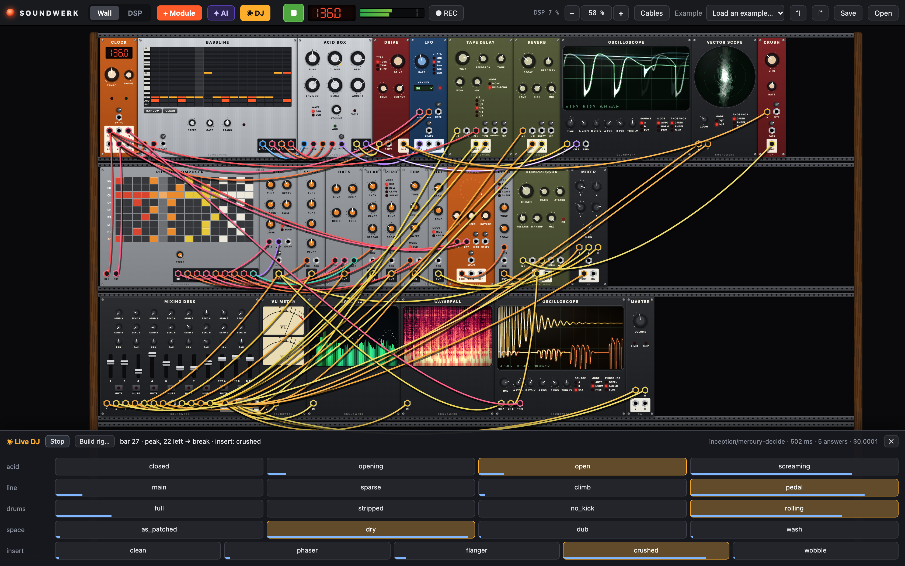

# Soundwerk

[](https://www.patreon.com/AndersBjarby)

A wall of synthesizers, oscilloscopes, sequencers and patch cables in your browser:
the rack in the corner of a techno studio, with an acid box, drum voices, tape echo, a
mixing desk and phosphor screens, all of it live, all of it patchable with hanging cables.
The sound sibling of [Patchwerk](https://github.com/fltman/patchwerk).



```bash
npm start          # → http://localhost:8280
```

No build step and no dependencies at runtime: plain ES modules, one AudioWorklet and a
canvas or two. Chrome, Edge or Arc. The server only exists to set the two headers that
`SharedArrayBuffer` needs, and to keep the API key for the assistant and the DJ.

## Using it

- **▶ or Space** starts every clock on the wall. Browsers only allow sound after a
  click, so the audio engine switches on with the first press. The display next to it
  shows and sets the tempo of the first Clock: drag it up or down.
- **Patch.** Double-click a rail or press <kbd>Tab</kbd> to add a module. Drag from jack
  to jack. Everything is volts, as in Eurorack, so anything goes into anything, and
  cables may form loops. An output takes as many cables as you like, an input takes one.
  The colours tell you what a cable carries: yellow audio, blue pitch, red gates, green and
  purple control voltages.
- **Zoom in to read the panels.** Double-click a module and it fills the screen; double-click
  it again to go back to the whole wall. Or use the − and + in the top bar, <kbd>+</kbd> / <kbd>−</kbd>,
  <kbd>⌘+</kbd> / <kbd>⌘−</kbd>, pinch, or ⌘-scroll. Hover over any knob or jack and it says
  what it is, at any zoom.
- **Move around** by dragging the wall or any panel, two-finger scroll, or the arrow keys.
  A module itself moves when you drag it by its name.
- **Unplug** by dragging a plug off its input, double-clicking the cable, or ⌥-clicking it.
- **Knobs:** drag up or right, hold <kbd>Shift</kbd> for fine control, double-click for the
  default, right-click to type a value. A jack with a small trim knob above it drives a
  knob: value = knob + cable × trim. A yellow dot shows where the cable has it right now.
- **Sequencers:** paint notes, accents and slides on the Bassline, or press RANDOM. Paint
  steps on the Rhythm Composer. The Analog Sequencer has knobs, as it should.
- **Cables in the way?** <kbd>C</kbd> cycles solid, faint and hidden.
- **✦ AI** (⌘K): describe what you want — "a dark acid track at 138", "dub chords
  drowning in tape echo" — and the patch assistant builds it, measures the result, and
  fixes what's off. Each AI edit is one ⌘Z. Runs Claude Sonnet 5.5 through OpenRouter:
  `OPENROUTER_API_KEY` must be set where you run `npm start` (the key stays on the server,
  which listens on 127.0.0.1 only). Override the model with `SOUNDWERK_MODEL`.
- **◉ DJ:** a fast decision model performs the patch, live. The Acid wall comes with a rig, so
  open the panel and press Start; on any other patch press *Build rig…* and the assistant writes
  one. A rig is a list of moves: knobs turning, new patterns, cables replugged, effects that
  appear on the wall and leave again. Every few bars the model picks from them, and each move
  lands exactly on a downbeat. Every move is rendered first, and one that goes silent, jumps in
  level or changes nothing is struck out and never played. If the wall goes silent or the
  limiter works too hard, code sends everything back home. Click a pad to play a move yourself,
  and turn the **Daring** knob, also during a set: low plays it safe, high goes for the surprising
  move and changes more often. It never plays a move that failed its test.
  About a cent an hour on `inception/mercury-decide`; override it with `SOUNDWERK_DJ_MODEL`.
- **⇢ Patchwerk:** send the wall to [Patchwerk](https://github.com/fltman/patchwerk) on the same
  machine and its pictures follow the music: its Clock, its drum hits, its sound and the shape
  of a DJ set, about 15 ms behind the engine. Press **◉ Soundwerk** there. The button stays on.
- **DSP tab:** read the source of any module, *Fork* it into a live-editable Code module,
  or write your own: `// param cut -3 3 0 "CUT" cv` in a comment becomes a knob with a jack,
  and `function tick(i, o, p)` runs once per sample. If it throws, that module stops and the
  wall plays on.
- **Your own tracks:** drop an audio file anywhere and a Track Deck appears. It analyses
  the beat, so its 1/16 and BAR jacks clock the wall to the track, with the real timing of
  the recording rather than a fixed tempo. Drop a file on a Sampler to play it from cables.
- **Outside the browser:** a MIDI In module takes notes, velocity, mod wheel and clock from
  your gear; with it selected the computer keyboard plays it too (`a s d f…`, `z x` for
  octaves). An Audio In module takes the microphone or line input.
- **● REC** writes what you hear to a 32-bit WAV. Patches save to the browser
  automatically; *Save / Open* for files.

<kbd>Space</kbd> play · <kbd>⌫</kbd> delete · <kbd>⌘D</kbd> duplicate ·
<kbd>⌘Z</kbd>/<kbd>⇧⌘Z</kbd> undo/redo · <kbd>+</kbd> <kbd>−</kbd> zoom · <kbd>1</kbd> 100 % ·
<kbd>F</kbd> or <kbd>0</kbd> whole wall · arrows pan · <kbd>C</kbd> cables ·
double-click a module's name to read its source.

## The rack

| | |
|---|---|
| **Oscillators** | VCO · Supersaw · Chord · FM · Wavetable · Noise · Pluck |
| **Synth voices** | Acid Box · Mono Synth |
| **Drums** | Kick · Snare · Hats · Clap · Tom · Perc · Ride |
| **Filters** | Ladder · Diode · SVF · Comb · Formant · DJ Filter |
| **Waveshapers** | Drive · Folder · Crush · Ring Mod |
| **Modulation** | LFO · ADSR · Decay ENV · Wander · S&H · Slew · Follower |
| **Sequencers & clocks** | Clock · Divider · Bassline · Rhythm Composer · Analog Sequencer · Euclid · Turing · Quantizer · Chance |
| **Utilities** | VCA · Mixer · Offset · Xfade · Switch · Logic · Compare · Pan |
| **Effects** | Tape Delay · Reverb · Spring · Chorus · Phaser · Flanger · Compressor · EQ3 · Stutter |
| **Mix & output** | Mixing Desk · Master |
| **Scopes & meters** | Oscilloscope · Vector Scope · Spectrum · Waterfall · VU Meter |
| **Audio in & MIDI** | Track Deck · Sampler · Audio In · MIDI In |
| **Code** | Code (your own, in JavaScript) |

70 modules plus Code. Nine example patches are in the menu: Acid wall, Dub techno, Warehouse, Talking acid, Berlin school, Generative plucks, Drone wall, Lissajous and Feedback. *Empty wall* gives you a bare rack with only the Master.

## How it works

- `src/engine/rack.js` is the engine: every instance, every cable, one sample at a time, in
  dependency order. A cable that closes a loop reads the value from one sample ago, so
  feedback patches behave as they do on hardware, only with a shorter wire. It is pure
  JavaScript, and the AudioWorklet and Node run exactly the same code. That is the point:
  every module and every patch can be rendered offline and measured.
- `src/modules/` is the library. **`src/modules/CONTRACT.md` is the contract** for writing a
  module. Each is a plain object with its knobs and jacks and one small DSP class.
- `src/wall/` is everything you see. Nobody draws a panel: `layout.js` computes each one from the
  module's definition, in HP, the way a panel maker would. LEDs, cables and scope traces
  arrive from the audio thread through shared memory, without a single allocation.
- `src/listen/` is the ears: an offline render, loudness to ITU BS.1770, tonal balance,
  tempo. The assistant's `listen` tool, `tools/render.mjs` and the tests all use it.
- `src/analysis/` is Patchwerk's beat tracker, for the Track Deck.
- `src/dj/` is the live DJ. The assistant writes a rig (`rig.js`), the engine renders every move
  through the same Rack (`audition.js`), and `dj.js` asks the model on each downbeat. Code
  decides when, the model decides which, and a late answer means nothing changes. The audio
  thread holds each change until the Clock reaches its step, so a new pattern is what the
  downbeat plays. When a group moves on, whatever its move added goes and the cables it
  replaced come back.

## Tests

```bash
npm test            # every module against what it should do, and the checks below
npm run smoke       # boot the app in Chrome, muted, and check that sound flows
npm run interact    # drive the wall with a real mouse; Code, files, MIDI keys, mic, REC
npm run presets     # play and screenshot every example → test/out/
npm run perf        # true DSP cost of each example, and dropouts in a live run
npm run dj          # a whole DJ set in the real app, against a stand-in model
npm run dj -- --real 120    # two minutes against the real one, for a fraction of a cent
npm run ai-live     # the assistant against the real model (spends a few cents)
```

`npm test` runs every module through the same gauntlet: fuzzing with garbage on every jack
at three sample rates, dead-knob detection, a time budget, a check that its source forks
into a Code module that sounds identical to the sample, and a panel that fits. On top of that
each family is calibrated from outside: oscillators against pitch and alias bars, filters
against cutoff and slope, reverbs against RT60, the examples against three finished tracks.

Nobody has listened to any of this during the build: all of it was measured. Your ears are
the test that's missing.

```bash
node tools/render.mjs "Acid wall" --bars 16    # bounce to WAV + spectrogram, faster than real time
```

## License

MIT © 2026 Anders Bjarby
